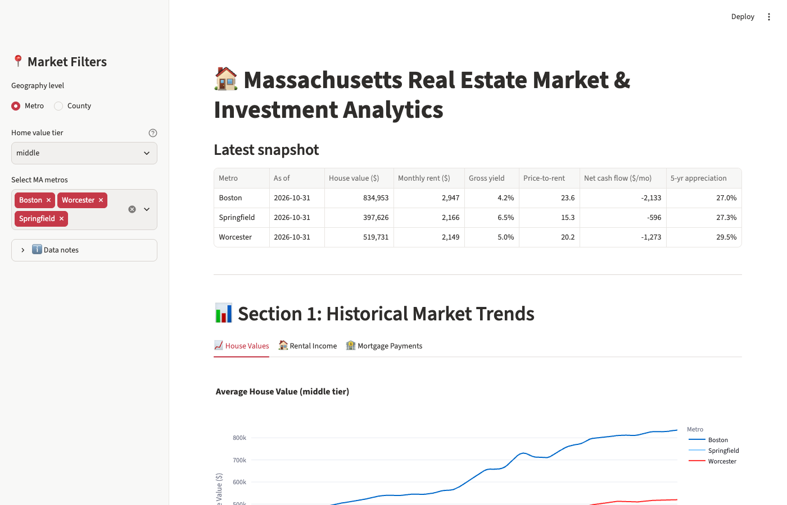
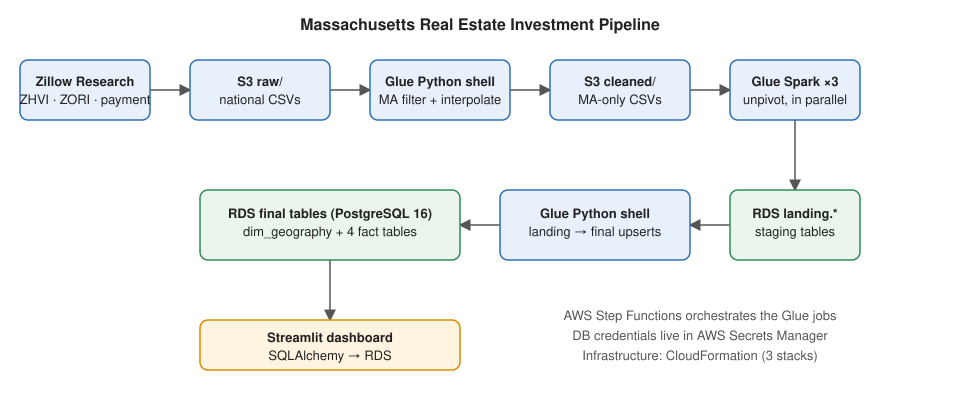

# Massachusetts Real Estate Investment Analysis

An end-to-end AWS data pipeline and Streamlit dashboard that asks: **is buying in a given Massachusetts metro or county a sound investment?** It looks at two return sources using Zillow Research data:

1. **Capital appreciation** – change in typical home value (ZHVI) over time, including 5-year appreciation.
2. **Rental income** – typical rent (ZORI) vs. the estimated monthly mortgage payment.

Derived metrics: **gross rental yield**, **price-to-rent ratio**, **net monthly cash flow** (rent − mortgage), **5-year appreciation**, plus ZIP-level rent rankings.



Inspired by [DAMG7370-WashingtonRealEstateInvestmentAnalysis](https://github.com/NU-YaoLi/DAMG7370-WashingtonRealEstateInvestmentAnalysis), adapted to Massachusetts with a few changes (see below).

## Architecture



```
Zillow CSVs ──► S3 raw/ ──► Glue Python shell: filter to MA, interpolate gaps ──► S3 cleaned/
                                      │
        Step Functions ───────────────┘
              ├─► Glue Spark (parallel): house value │ monthly payment │ rent  ─► RDS landing.*
              └─► Glue Python shell: landing.* ─► dimensional model (upserts)   ─► RDS final tables
                                                                                   │
                                                              Streamlit dashboard ◄┘
```

| Component | Tool |
| :-- | :-- |
| Infrastructure as code | AWS CloudFormation (3 stacks) |
| Data lake | Amazon S3 |
| Orchestration | AWS Step Functions |
| ETL | AWS Glue (PySpark + Python shell) |
| Warehouse | Amazon RDS PostgreSQL 16 |
| BI | Streamlit + Plotly |

### Data model
`dim_geography(metro_name, county_name)` – `county_name = 'All counties'` marks a metro-grain row.
`fact_house_value` (by tier: bottom/middle/top), `fact_rental_income`, `fact_monthly_payment` (metro grain only), `fact_zip_rent`.
Loads are idempotent upserts, so the pipeline can be re-run.

### Source data (Zillow Research, public)
ZHVI City (3 price tiers), ZORI ZIP, and Metro total monthly payment (20% down, middle tier). Only Massachusetts rows are kept.

## Differences from the Washington reference
- Spark jobs read the **cleaned** files (the reference's read raw).
- ZHVI is kept **per price tier** and the dashboard defaults to the middle tier, matching the mortgage series, instead of averaging tiers together.
- Metro names are normalised (`Boston-Cambridge-Newton, MA-NH` and `Boston, MA` → `Boston`) instead of hard-coded renames.
- County and ZIP views added; MA ZIP leading zeros restored.
- Account-scoped bucket name; the DB password lives in **AWS Secrets Manager** (`ma-house/db`) and Glue jobs read it at run time instead of receiving it as a job argument; no credentials committed.

## Project structure
```text
CloudFormation/   01-storage-iam.yaml, 02-database.yaml, 03-full-etl.yaml
PythonScript/     data_clean.py, etl_house_value.py, etl_monthly_payment.py,
                  etl_rental_income.py, lnd_to_final_data_load.py
Visualization/    dashboard.py (+ .streamlit/secrets.toml.example)
scripts/          download_zillow.py, deploy.sh, teardown.sh
docs/             architecture.svg, dashboard.png
.github/workflows tests.yml (CI: pytest on every push)
tests/            test_clean.py
```

## Deploy
Needs the AWS CLI configured. Costs apply (RDS, Glue).
```bash
pip install -r requirements.txt
DB_PASSWORD='choose-a-password' ./scripts/deploy.sh
```
The password may use letters, digits and `_ . ! # % ^ * + = -`. The script deploys the stacks, uploads scripts and Zillow files to S3 and starts the Step Functions run.

**Stop the charges** (RDS bills ~$0.02/hr while it exists): `./scripts/teardown.sh` deletes the stacks, the S3 data and the database.

## Run the dashboard
```bash
cp Visualization/.streamlit/secrets.toml.example Visualization/.streamlit/secrets.toml   # fill in RDS details
cd Visualization && streamlit run dashboard.py
```

## Host the dashboard (optional)
1. Push this repo to GitHub (done) and sign in at <https://share.streamlit.io> with GitHub.
2. New app → this repo, branch `main`, main file `Visualization/dashboard.py`.
3. In *Advanced settings → Secrets*, paste the `[postgres]` block from `secrets.toml.example` with your RDS details.
4. The RDS instance must be reachable from the internet (the default security group is open; see caveats).

## Tests
```bash
pytest tests
```

## Caveats
- The RDS security group defaults to `0.0.0.0/0` (password-protected) because Glue jobs run outside a VPC. Restrict `AllowedCidr` or move Glue into the VPC for anything beyond a class project.
- Metro/county figures are simple averages of city/ZIP series; Zillow doesn't publish every metric for every place. Providence and Vineyard Haven appear because Zillow metros span state lines or islands; only their MA parts are included.
- Cash flow = rent − mortgage payment only; it ignores taxes, insurance, vacancy and upkeep.
- Not investment advice.
- Validation: the full pipeline (CloudFormation → Glue → Step Functions → RDS) has been run successfully in AWS, and the dashboard was verified against the resulting database. The PySpark jobs have no automated tests beyond that end-to-end run.
