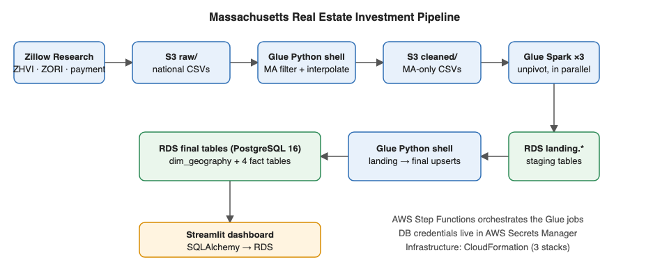
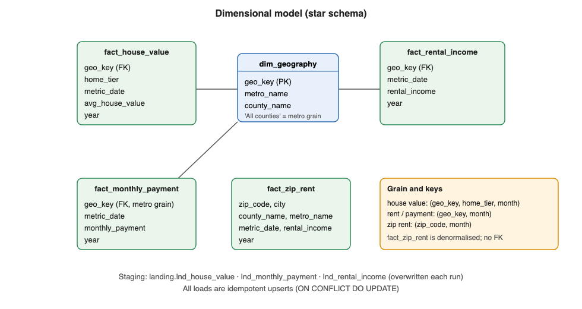

# Massachusetts Real Estate Investment Analysis — Project Report

## 1. Objective
Decide, with data, whether buying residential property in a given Massachusetts market is a sound investment. Two return sources are analysed:

1. **Capital appreciation** – growth in typical home value.
2. **Rental income** – typical rent compared with the cost of owning (mortgage payment).

The project builds an automated, reproducible data platform on AWS and a dashboard on top of it. It adapts the design of a Washington State project to Massachusetts.

## 2. Data
All data is public from [Zillow Research](https://www.zillow.com/research/data/) and covers Massachusetts only after filtering.

| Dataset | Grain | Months | Role |
|---|---|---|---|
| ZHVI home value index, 3 price tiers (bottom / middle / top third) | City | 2015-01 → 2026-10 | Appreciation, price level |
| ZORI observed rent index | ZIP code | 2015-01 → 2026-10 | Rental income |
| Total monthly payment (20% down, middle tier) | Metro | 2012-01 → 2026-10 | Cost of owning |

Source files are national (~100 MB each for ZHVI); after filtering to MA they are 355 cities, 201 ZIPs and 5 metros.

## 3. Architecture

| Layer | Technology | Responsibility |
|---|---|---|
| Infrastructure as code | CloudFormation (3 stacks) | Storage + IAM, database, ETL + orchestration |
| Data lake | S3 (`raw/`, `cleaned/`, `scripts/`) | Landing zone for national CSVs and cleaned MA files |
| Cleaning | Glue Python shell (pandas) | Keep MA rows, trim text, linearly interpolate interior gaps, create `landing` schema |
| Transformation | Glue Spark (3 jobs, parallel) | Unpivot wide month columns to rows, derive `metro_name`/`home_tier`, write staging tables over JDBC |
| Orchestration | Step Functions | Clean → (3 Spark jobs in parallel) → load; retry on the first step |
| Warehouse | RDS PostgreSQL 16 | Staging + dimensional model |
| Serving | Streamlit + Plotly | Interactive analysis; reads RDS or a bundled snapshot |
| Secrets | Secrets Manager | DB credentials, read by Glue at run time |

## 4. Data model

* **Star schema.** One conformed dimension, `dim_geography(metro_name, county_name)`; rows with `county_name = 'All counties'` are metro-grain.
* **Why two grains?** Zillow publishes mortgage payments for metros only, while values and rents exist per city/ZIP. Metro-grain facts average *all* underlying cities/ZIPs directly (not averages of county averages), so a metro's figures are not distorted by small counties.
* **Price tiers** are kept as a column of `fact_house_value`. Averaging tiers together would mix very different homes, and the payment series is for the middle tier, so the dashboard defaults to *middle*.
* `fact_zip_rent` is denormalised for fast ZIP-level exploration.
* **Idempotency.** Staging tables are overwritten each run; all fact/dimension loads are `INSERT … ON CONFLICT DO UPDATE`, so the pipeline can be re-run safely.
* **Metro naming.** Zillow uses different names for one metro (`Boston-Cambridge-Newton, MA-NH` vs `Boston, MA`). A single rule (first token before `,` and `-`) produces `Boston`, replacing the per-city hard-coded renames of the reference project. Null metros become `Non-metro`.

## 5. Metrics
* **Gross rental yield** = rent × 12 ÷ home value
* **Price-to-rent ratio** = home value ÷ (rent × 12)
* **Net monthly cash flow** = rent − estimated mortgage payment (excludes taxes, insurance, vacancy, maintenance)
* **5-year appreciation** = value now ÷ value 60 months earlier − 1

## 6. Results (as of October 2026, middle price tier)

| Metro | Home value | Monthly rent | Gross yield | Price-to-rent | Mortgage payment | Net cash flow | 5-yr appreciation | 10-yr appreciation |
|---|---:|---:|---:|---:|---:|---:|---:|---:|
| Barnstable Town | $863,539 | $2,505 | 3.5% | 28.7 | $5,049 | −$2,544 | 30.7% | 97.6% |
| Boston | $834,953 | $2,947 | 4.2% | 23.6 | $5,080 | −$2,133 | 27.0% | 74.0% |
| Providence (MA part) | $576,502 | $2,097 | 4.4% | 22.9 | n/a | n/a | 30.0% | 85.3% |
| Worcester | $519,731 | $2,149 | 5.0% | 20.2 | $3,422 | −$1,273 | 29.5% | 86.8% |
| Pittsfield | $465,213 | $1,524 | 3.9% | 25.4 | $2,815 | −$1,290 | 29.7% | 84.4% |
| Springfield | $397,626 | $2,166 | 6.5% | 15.3 | $2,762 | −$596 | 27.3% | 74.7% |

**Findings**
1. **Appreciation was strong and broad.** Every metro gained 27–31% over five years and 74–98% over ten; differences between metros are small compared with the overall trend.
2. **No metro cash-flows positively with 20% down.** Rent covers only 50–78% of the estimated mortgage payment. Returns at current prices depend on continued appreciation, not rent.
3. **Springfield is the best income market** (6.5% yield, price-to-rent 15.3, smallest cash-flow gap) while Boston and Barnstable are the most expensive relative to rent (price-to-rent 24–29).
4. **Rents cluster by place, not just metro.** Highest ZIP rents are in Boston (02199 $5,325; 02120 $4,430), Manchester-by-the-Sea (01944 $4,500) and Somerville (02144 $4,331); lowest are Pittsfield (01201 $1,524), Springfield (01103 $1,585) and New Bedford (02744 $1,633).
5. **County view (yield, middle tier)** ranges from 3.5% (Barnstable) to 7.6% (Hampshire). Franklin County shows 13.2%, which is an artifact: its rent average comes from very few ZIPs (one at $4,198) while values are averaged over many small towns. Treat county numbers for sparsely covered counties with caution.

## 7. Validation and engineering notes
* **End-to-end run on AWS:** the Step Functions state machine completed successfully (clean → 3 parallel Spark jobs → load); resulting RDS tables were checked against an independent pandas reproduction and matched on the headline figures (e.g. Boston $834,953, Springfield $397,626).
* **Automated tests (run in CI):** unit test of the cleaning function; the three real Glue Spark scripts executed locally on fixtures with AWS libraries stubbed.
* **Defects found and fixed while building:**
  * pandas 3 string dtype silently skipped whitespace trimming (caught by unit test).
  * A month column that is entirely empty after the MA filter would be inferred as text and break Spark's `stack()` — all month columns are now cast to double (caught by the Spark test; it did not occur in the real data).
  * ZIP codes lose their leading zero when read as integers (`02108` → `2108`); restored with `lpad`.
  * The cleaning job needed 1 Glue DPU, not 1/16, to hold national CSVs in memory.
  * The reference project's Spark jobs read *raw* files and bypassed cleaning; here they read the cleaned MA files.
* **Security improvements over the reference:** DB password in Secrets Manager instead of job arguments; no credentials committed; account-scoped bucket name.

## 8. Limitations
* Zillow indices are *typical* values, not individual transactions; no property-level costs.
* City-level home values and ZIP-level rents are matched through county/metro averages; places are weighted equally regardless of housing stock.
* Cash flow ignores property tax (high in MA), insurance, vacancy and maintenance, and uses one mortgage assumption (20% down, middle tier).
* Providence and Vineyard Haven are Zillow metros that cross state lines/islands; only their Massachusetts parts are included.
* The RDS security group is open to all IPs (password-protected) because Glue runs outside a VPC; acceptable for a course project, not production.
* Past appreciation does not predict future returns. This is not investment advice.

## 9. Reproducibility and cost
* Deploy: `DB_PASSWORD='…' ./scripts/deploy.sh` (≈15 min). Tear down: `./scripts/teardown.sh`.
* Typical cost while deployed: RDS `db.t4g.micro` ≈ $0.02/hour plus a few cents of Glue per run.
* The repository contains a small snapshot of the final tables (`data/demo/`) so the dashboard runs anywhere without AWS.

## 10. Possible extensions
Property-tax and insurance assumptions; interest-rate scenarios; ZIP-level home values for ZIP-level yield; forecasting (e.g. ARIMA/Prophet) with backtesting; moving Glue into a VPC and closing public database access; a scheduled monthly refresh via EventBridge.
